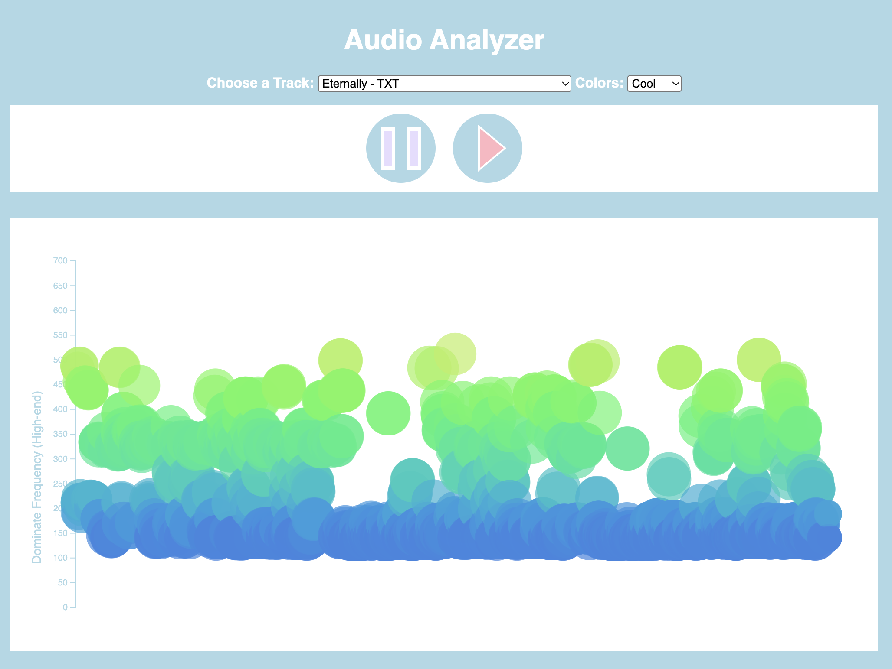

Assignment 1 - Hello World: GitHub and d3  
===

#### url: https://sugie244.github.io/a1-ghd3/

Description 
----
This program visualizes songs based on their position in the duration (for example, 1 minute 2 seconds into a 3 min song) and the dominate frequency of the high-end portion
of the audio (vocals). The color of the generated circles will also differ based
on the vocal index. The radius of the circles are generated based on the 
bass volume at that point. Unfortunately, while
your own music cannot be uploaded, I have provided a couple of songs to use as a reference.
If you do not like the color scheme chosen for the visualization, you can change it at any 
point of the song by editing it in the dropdown menu. 

Below are two examples of the visualizations made:

Eternally by TXT, using cool interpolation

I'M A BLACKHOLE (STAR) - Odetari, using Turbo interpolation

Technical and Design Achievements
---

## Technical
I had never used the d3 library before, and was able to learn and make
a small player with a play and pause button using SVGs (rectangles,
lines, circles, and polygons). Some parts of the code no longer exist,
but at some point I had it so the circles would be animated in, so I got
some experience in that regard. I also learned how to scale the x axis to account for the 
duration of the song, and how to select different color schemes to 
go along with the visualization. 

Unrelated to d3, but I also got some experience with AnalyserNode to get the audio data needed to create
the visualization. With the help of the documentation and https://blog.addpipe.com/understanding-audio-frequency-analysis-in-javascript-a-guide-to-using-analysernode-and-getbytefrequencydata,
I learned more about audio as a whole (for example, about how only half of FFT (Fast Fourier Transform) is unique,
and how even from the 1024 bits (if you had set fftsize to 2048), further splitting is required in order to 
have the bins in vocal vs. bass). I don't really know a whole lot about music, so this was a fun learning experience!

## Design
While it is simple, I think the design turned out pretty well! I was able to utilize the SVGs to create
a well-designed player, and experimented a lot with the generation of the circles. While ultimately
I gave the choice for the user to choose the type of color hues used for the visualization, 
I did try to pick interpolations that I thought would best fit the website and that would appear best on 
the white background. I like the addition of the y-axis to better show the value the circles roughly are.
Originally, I had the circles only be generated once per second, and had an animation of the circle starting 
small and opening to the size it should be. However, I found it more visually appealing when I edited it 
so circles are created more frequently without the transition. 

README Quality
- A description of what you have created. 1-2 screenshots are recommended for the README.  
- A working link to the hosted files (your GitHub Pages url)  
- Section for Technical and Design Achievements

